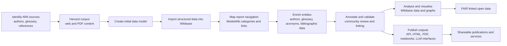

# Workflow

The Climate Knowledge Graph (CKG) workflow turns an unstructured climate science corpus into structured, queryable, and publishable knowledge. Beginning with IPCC AR6 sources, the process moves through harvesting, knowledge modelling, Wikibase import, annotation, analysis, and publication outputs. The result is a FAIR, linked data environment that supports both research and publication-ready outputs.

## Schematic

## Workflow summary

Working with the IPCC Sixth Assessment Report (AR6) corpus, the project follows a sequence of stages that convert source material into structured knowledge and reusable publication outputs.

1. Identify relevant report sources and metadata, including authors, glossary terms, acronyms, references, and bibliographic material.
2. Harvest the report corpus from web and PDF sources.
3. Design an initial knowledge graph data model suited to the report structure and research use cases.
4. Import the data into Wikibase as the central knowledge graph store.
5. Link the report content to media and navigation structures in MediaWiki for browsing and discovery.
6. Harvest and import additional supporting data such as authors, glossary terms, acronyms, references, and bibliographic records.
7. Annotate the report using the imported data and related entities.
8. Support community annotation and review through established knowledge-sharing communities and linked-data workflows.
9. Map relevant data to Wikidata and related knowledge structures where appropriate.
10. Perform analysis, visualisation, and data exploration over the resulting graph.
11. Generate publication outputs from the graph using computational publishing workflows.
12. Deliver searchable, shareable, and machine-readable outputs such as REST APIs, RDF data, HTML publications, and LLM-ready knowledge services.

## Main stages and outputs

| Stage | Purpose | Outputs |
| --- | --- | --- |
| Source identification | Gather report materials and core metadata | Authors, glossary, acronyms, references, bibliographic fields |
| Corpus harvesting | Collect raw report content from web and PDF inputs | Structured text and document corpus |
| Knowledge modelling | Design the graph schema for report and entity relationships | Initial ER/data model |
| Wikibase import | Load core entities and metadata into the knowledge graph | Structured graph data |
| Navigation and linking | Connect report content to browsable structures | MediaWiki categories, report links, entity navigation |
| Enrichment | Add supporting data and metadata | Glossary, author records, bibliographic details, references |
| Annotation and review | Add semantic meaning and community validation | Linked report content, collaborative annotations |
| Analysis and visualisation | Query and explore knowledge graph data | Graph analysis, summaries, figures, derived insights |
| Publication | Turn graph content into shareable outputs | REST API, HTML, notebooks, PDF-like layouts, machine-readable data |
| FAIR data services | Make knowledge reusable and interoperable | RDF export, API access, linked open data, publication services |

## Publication model

The publication layer uses a computational publishing service that turns Wikibase content into HTML and other formats. This approach supports multi-format publishing, including PDF-like layouts via paged media CSS, while keeping the underlying knowledge in the graph so it can be reused for search, analysis, and machine-readable outputs.

